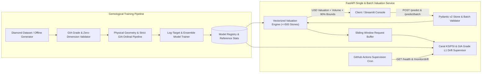

# Diamond Valuation API

[](https://github.com/Rahul-git64/diamond-valuation-api/actions/workflows/ci.yml)
[](https://github.com/Rahul-git64/diamond-valuation-api/actions/workflows/cd-deploy.yml)
[](https://github.com/Rahul-git64/diamond-valuation-api/actions/workflows/supervision-cron.yml)
[](https://www.python.org/downloads/)
[](https://fastapi.tiangolo.com)

An end-to-end gemological diamond valuation pipeline that enforces strict **GIA ordinal grade hierarchies**, engineers **physical stone geometry features (`volume_mm3`, `table_to_depth_ratio`, `depth_deviation_pct`)**, serves both single (`POST /predict`) and high-throughput **500-stone batch (`POST /predict/batch`)** FastAPI endpoints, and monitors carat weight (KS/PSI) and GIA grade ($L_1$) drift.

---

## System Architecture



---

## Key Engineering Upgrades

1. **Domain-Accurate Gemological Pipeline (Strict GIA Ordinal Hierarchies):**
   - Fixes the reference implementation's inverted color grade bug by enforcing strict worst-to-best GIA ordinal encodings in `OrdinalEncoder`:
     - `cut`: `Fair < Good < Very Good < Premium < Ideal`
     - `color`: `J < I < H < G < F < E < D` (where `J` is faintly tinted and `D` is colorless)
     - `clarity`: `I1 < SI2 < SI1 < VS2 < VS1 < VVS2 < VVS1 < IF`
2. **Physical Geometry Engineering & Zero-Dimension Filtering:**
   - Filters corrupted zero-dimension (`x=0`, `y=0`, `z=0`) records and computes `volume_mm3 = x * y * z`, `table_to_depth_ratio = table / depth`, `length_to_width_ratio = x / y`, `depth_deviation_pct = |depth - 200*z/(x+y)|`, and `log_carat = log(1 + carat)`.
3. **Single & High-Throughput Batch Valuation (`POST /predict` & `POST /predict/batch`):**
   - Supports single stone appraisals and vectorized batch portfolio appraisals of up to **500 stones per request**, returning total portfolio value, mean stone value, per-carat price, physical volume, and 90% prediction intervals.
4. **Carat & GIA Grade Drift Supervision (`GET /monitor/drift`):**
   - Monitors continuous gemological features (`carat`, `depth`, `table`, `x`, `y`, `z`) via two-sample Kolmogorov-Smirnov (`ks_2samp`) and Population Stability Index (PSI), alongside categorical $L_1$ distribution shifts across `cut`, `color`, and `clarity`.

---

## Holdout Model Benchmarks

| Estimator | $R^2$ | RMSE (USD) | MAE (USD) | MAPE (%) | Notes |
| :--- | :---: | :---: | :---: | :---: | :--- |
| **LogRidge (`TransformedTargetRegressor`)** | **0.9738** | **$542.07** | **$192.94** | **5.39%** | Selected Estimator ($\log(1+y)$ power-law fit) |
| **GradientBoostingRegressor** | 0.9689 | $590.17 | $244.80 | 6.50% | Boosted decision trees |
| **RandomForestRegressor** | 0.9484 | $760.49 | $372.27 | 10.43% | Bagged decision trees |

---

## Quickstart & Docker Usage

```bash
# Install dependencies, run linter, and execute test suite
pip install -e ".[dev]"
ruff check .
pytest -v

# Train model artifacts and start FastAPI server
python scripts/train.py
uvicorn diamond_valuation.api.main:app --host 0.0.0.0 --port 8000 --reload

# Pull and run verified container from GitHub Container Registry (GHCR)
docker pull ghcr.io/rahul-git64/diamond-valuation-api:latest
docker run -p 8000:8000 ghcr.io/rahul-git64/diamond-valuation-api:latest
```

---

## API Reference

### `POST /predict` (Single Stone)

```bash
curl -s -X POST http://localhost:8000/predict \
  -H "Content-Type: application/json" \
  -d '{
    "carat": 1.15,
    "cut": "Ideal",
    "color": "E",
    "clarity": "VVS2",
    "depth": 61.8,
    "table": 57.0,
    "x": 6.72,
    "y": 6.75,
    "z": 4.16
  }' | jq
```

### `POST /predict/batch` (Up to 500 Stones)

```bash
curl -s -X POST http://localhost:8000/predict/batch \
  -H "Content-Type: application/json" \
  -d '{
    "stones": [
      {"carat": 1.15, "cut": "Ideal", "color": "E", "clarity": "VVS2", "depth": 61.8, "table": 57.0, "x": 6.72, "y": 6.75, "z": 4.16},
      {"carat": 0.85, "cut": "Premium", "color": "G", "clarity": "VS1", "depth": 62.1, "table": 58.0, "x": 6.08, "y": 6.11, "z": 3.79}
    ]
  }' | jq
```

---

## License

Distributed under the MIT License.
